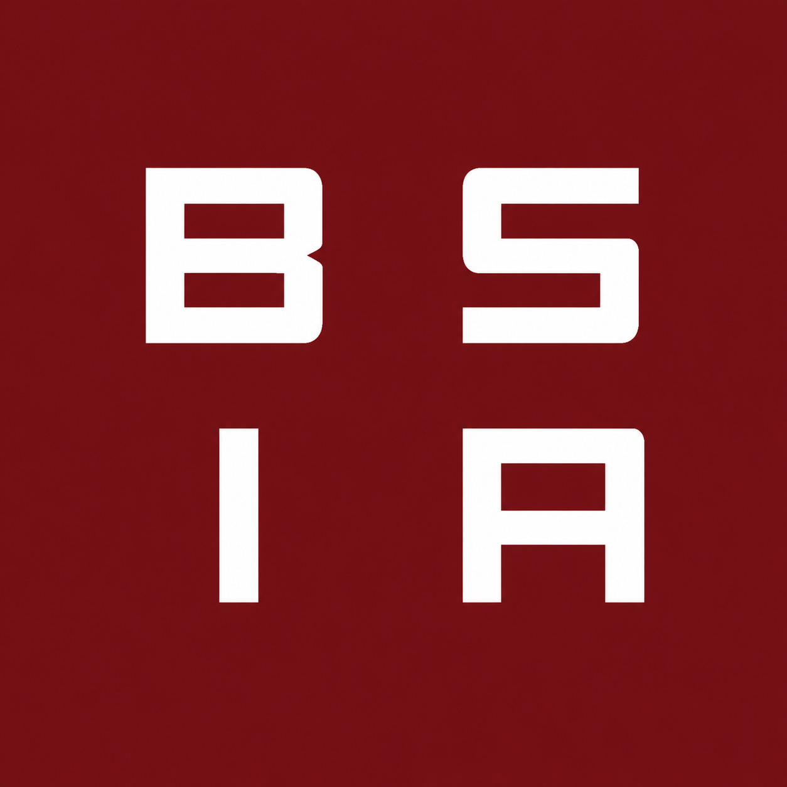
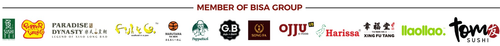

 

# BISA GROUP

### One Vision. Multiple Brands.

Building exceptional dining experiences through quality, innovation, and great service.

**Medan, Indonesia · Food & Beverage**

[Website](https://bisagroup.co.id) · [GitHub](https://github.com/IT-Bisa-Group)

---

## About Us

BISA Group is a growing Food & Beverage company based in Indonesia, bringing together multiple brands under one vision.

We focus on delivering quality products, memorable experiences, and sustainable business growth through innovation and operational excellence.

## Technology & Innovation

Our technology team develops digital solutions to support business operations, improve efficiency, and drive innovation.

Our focus areas:

- **Business Applications** — Solutions for daily operations.
- **Enterprise Systems** — Integrated business management.
- **Web & Mobile** — Modern digital experiences.
- **Infrastructure & Integration** — Reliable and connected systems.
- **Digital Innovation** — Technology-driven business growth.

## Explore Our Projects

Discover our digital initiatives and engineering projects.

[**Explore All Repositories →**](https://github.com/orgs/IT-Bisa-Group/repositories)

## Our Brand Family

*Multiple brands, one vision, creating experiences together.*

---

**BISA GROUP TECHNOLOGY TEAM**

*Building digital solutions that move our business forward.*

[bisagroup.co.id](https://bisagroup.co.id) · ithelpcenter@bisagroup.co.id

